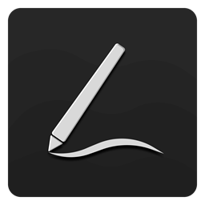

  
  <h1>NextTabletDriver</h1>
  

    A fast, free and open-source driver for drawing tablets. 
    Made for osu!, and for everyday pen input.
  

  

    
    
    
    
    
  

> **Attribution notice:** The tablet definitions in [`tablets/OpenTabletDriver`](tablets/OpenTabletDriver) are a git submodule that points to the [OpenTabletDriver](https://github.com/OpenTabletDriver/OpenTabletDriver) project. That project uses the **GNU Lesser General Public License v3.0 (LGPLv3)**. The submodule keeps this content separate from NextTabletDriver's own MIT license. It is not copied into the MIT-licensed source code. See [License](#license).

## What is NextTabletDriver?

A tablet driver is the program that turns the movement of your pen into the movement of the cursor on your screen. NextTabletDriver is a driver that you can use instead of the one from your tablet's maker. It reads the tablet directly, so it does not need that driver.

It works with tablets from many brands, so you can use one driver for all of them. It is written in [Rust](https://www.rust-lang.org) with a focus on low input delay.

## What it can do

- **Absolute and relative mode.** Map a part of your tablet to a part of your screen, or move the cursor like a mouse.
- **A visual area editor.** Set the size, position and rotation of the area you use. Lock the aspect ratio, snap to the edges of your screens, and show where the osu! playfield sits inside your area.
- **Pressure settings.** Choose how hard you must press for a click, and reshape the pressure with a curve.
- **Profiles.** Save your settings, switch between them from the menu or the tray, share them as files, and import your settings from OpenTabletDriver.
- **Plugins.** Add filters that smooth the pen path. You can write your own.
- **Themes.** Pick a built-in theme, or make one in a small JSON file.
- **Live data for other programs.** A local WebSocket server for stream overlays, and an SDK to embed the driver in your own program.
- **Runs quietly.** It can start with your computer and live in the system tray.

## Supported tablets

NextTabletDriver reads its tablet definitions from [OpenTabletDriver](https://github.com/OpenTabletDriver/OpenTabletDriver). It includes more than 350 of them, from 26 brands, including:

- **Wacom** (Intuos, Bamboo, Cintiq and more)
- **Huion** (including Kamvas)
- **XP-Pen** and **UGEE**
- **Gaomon**, **VEIKK**, **Artisul**, **Parblo**, **XenceLabs**, **UC-Logic**, and others

A definition only works if this project also has the matching *parser*, the code that reads that tablet's data. Not every tablet has been tested. If yours does not work, see [Adding a tablet](docs/adding-a-tablet.md). Help is welcome.

## Windows and Linux

| | Windows 10 and 11 | Linux (X11 and Wayland) |
| --- | --- | --- |
| Cursor position and click | Yes | Yes |
| Pressure and tilt sent to other programs | **No.** The driver acts like a mouse. | Yes |
| Extra setup | None | [udev rules](docs/linux.md) |

On Windows, osu! works well, because it only needs position and a click. Drawing programs that need pressure do not get it yet.

## Install

### Windows

1. Download `NextTabletDriver_<version>_x64-setup.exe` from the [releases page](https://github.com/Next-Tablet-Driver/NextTabletDriver/releases). On an ARM PC, download the `arm64` file.
2. Run it. If an older version from the Inno Setup installer is present, it is removed first.
3. Start NextTabletDriver and plug in your tablet.

The installer is not code-signed yet, so Windows SmartScreen may show a warning. Choose **More info**, then **Run anyway**.

### Linux

The [releases page](https://github.com/Next-Tablet-Driver/NextTabletDriver/releases) has a `.deb` package (Debian and Ubuntu) and an AppImage, for x86_64 and ARM64. Linux needs permission to use your tablet and `/dev/uinput`. The [Linux setup](docs/linux.md) guide shows how, and also covers Arch Linux and NixOS.

### Build from source

See [Development](docs/development.md).

## Quick start

1. Plug in your tablet and start NextTabletDriver. The footer shows your tablet's name.
2. Open the **Output** tab. Set the display area to match your screen, and choose how much of the tablet you want to use.
3. Pick **Absolute Mode** in the footer.
4. Press **Ctrl+S** to keep your settings.

The [Getting started](docs/getting-started.md) guide explains every tab.

## Documentation

| I want to... | Read |
| --- | --- |
| Install and set up my tablet | [Getting started](docs/getting-started.md) |
| Fix a problem | [Troubleshooting](docs/troubleshooting.md) |
| Set up Linux | [Linux setup](docs/linux.md) |
| Smooth my pen movement | [Plugins](docs/plugins.md) |
| Write a plugin | [Plugin development](docs/plugin-development.md) |
| Change the colors | [Themes](docs/themes.md) |
| Use pen data in another program | [Integrations](docs/integrations.md) |
| Get a new tablet supported | [Adding a tablet](docs/adding-a-tablet.md) |
| Understand how it works | [Architecture](docs/architecture.md) |
| Build it and send a change | [Development](docs/development.md) and [Contributing](.github/CONTRIBUTING.md) |

All guides are listed in [`docs/`](docs/README.md).

## Privacy

NextTabletDriver does not collect or send usage data. It contacts GitHub only to check for updates, to show release notes, and to show the list of contributors. Its WebSocket server is off by default and only accepts connections from your own computer.

## Known limitations

- On Windows, pressure and tilt are not sent to other programs.
- The pen's side buttons and the eraser are not forwarded yet.
- The installers do not include any plugin yet. See [Plugins](docs/plugins.md#build-the-plugins-from-this-repository).
- The interface is in English only.

The full list, with workarounds, is in [Troubleshooting](docs/troubleshooting.md#known-limitations).

## Contributing

NextTabletDriver is open source and welcomes help. Good first contributions are adding a tablet, fixing a parser bug, improving Linux packaging, making a theme, and polishing the interface. Read [`CONTRIBUTING.md`](.github/CONTRIBUTING.md) to start, and [Development](docs/development.md) to build the project.

Need help or found a security problem? See [`SUPPORT.md`](.github/SUPPORT.md) and [`SECURITY.md`](.github/SECURITY.md).

## License

NextTabletDriver is distributed under the MIT License. See [`LICENSE`](LICENSE).

### Third-party licenses

The tablet definitions in [`tablets/OpenTabletDriver`](tablets/OpenTabletDriver) come from [OpenTabletDriver](https://github.com/OpenTabletDriver/OpenTabletDriver), which uses the **GNU Lesser General Public License v3.0 (LGPLv3)**. This submodule is a separate component under the terms of the LGPLv3. It is not relicensed under NextTabletDriver's MIT license. You can read the full LGPLv3 text at [gnu.org/licenses/lgpl-3.0](https://www.gnu.org/licenses/lgpl-3.0.html).

Copyright © OpenTabletDriver contributors.
